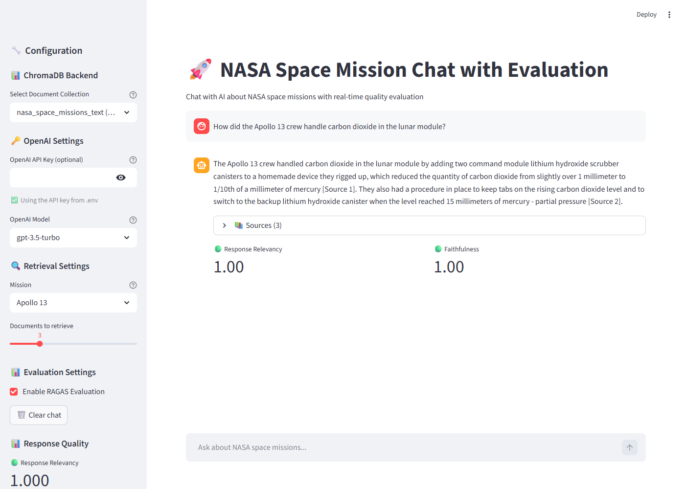

# NASA Mission Intelligence - RAG Chat System

My project for the Udacity Generative AI course. It is a chat app that answers questions about
three NASA missions (Apollo 11, Apollo 13 and Challenger STS-51L) using the original NASA
documents and transcripts. Every answer gets scored with RAGAS, so I can see how relevant it is
and whether it is actually supported by the documents.



## How it works

The data is 12 text files (about 6.4 MB): mission reports, the Apollo flight plan, air-to-ground
transcripts and the Challenger audio transcripts.

1. `embedding_pipeline.py` cuts the files into overlapping chunks, embeds them with OpenAI
   `text-embedding-3-small` and saves them in ChromaDB.
2. `rag_client.py` embeds the question with the same model, searches ChromaDB (you can choose
   how many chunks and filter by mission) and builds one context text with numbered sources.
3. `llm_client.py` sends the context, the chat history and the question to an OpenAI model.
   The system prompt tells it to act as a NASA mission expert, use only the context, cite the
   sources like `[Source 1]`, and say so when the documents don't have the answer.
4. `ragas_evaluator.py` scores the answer (Response Relevancy and Faithfulness, plus BLEU,
   ROUGE-L and context precision in the batch evaluation).
5. `chat.py` is the Streamlit app that puts everything together.

```
data_text/*.txt -> embedding_pipeline.py -> ChromaDB (chroma_db_openai/)

question -> rag_client.py -> llm_client.py -> answer -> ragas_evaluator.py -> scores
                         (all inside the Streamlit app chat.py)
```

## Files

```
chat.py                  Streamlit chat app
llm_client.py            OpenAI chat client (system prompt, history, context)
rag_client.py            ChromaDB search, mission filter, context formatting
embedding_pipeline.py    chunking, embeddings, update modes, stats
ragas_evaluator.py       RAGAS scoring + batch evaluation
evaluation_dataset.txt   my 7 test questions with expected answers
evaluation_results.csv   output of my last batch evaluation run
fix_ragas.py             fixes the RAGAS 0.4.3 import error (see Setup)
tests/                   test_chunking.py and test_rag_client.py
data_text/               the NASA documents (apollo11, apollo13, challenger)
docs/                    screenshot
.env.example             template for the API key
```

The ChromaDB folder (`chroma_db_openai/`, about 134 MB) and my `.env` are not in the repo.
You build the database yourself with step 1 below.

## Setup

I used Python 3.10 on Windows.

```bash
python -m venv .venv
.venv\Scripts\activate          # on Mac/Linux: source .venv/bin/activate
pip install -r requirements.txt
python fix_ragas.py
```

`fix_ragas.py` is needed because RAGAS 0.4.3 still imports `ChatVertexAI` and `VertexAI` from
old `langchain_community` paths, so `import ragas` fails with an ImportError. The course
instructions fix this with `sed` on `/opt/venv/...` (see `fix_ragas.png`). I wrote a small
script that makes the same change in whatever venv you use, so it also works on Windows.
Running it twice is fine.

Then copy `.env.example` to `.env` and put your key in it:

```ini
OPENAI_API_KEY=your-api-key-here
OPENAI_BASE_URL=https://openai.vocareum.com/v1
```

`OPENAI_BASE_URL` is only for the Udacity Vocareum key. With a normal OpenAI key you can delete
that line. The key is never written in the code, everything reads it from `.env`.

## Running it

### 1. Build the database

```bash
python embedding_pipeline.py --chunk-size 1000 --chunk-overlap 200
```

This took about 2.5 minutes for me and created 8,428 chunks from the 12 files.

Options:

| Flag | Default | What it does |
|---|---|---|
| `--data-path` | `./data_text` | folder with `apollo11/`, `apollo13/`, `challenger/` |
| `--chroma-dir` | `./chroma_db_openai` | where ChromaDB is saved |
| `--collection-name` | `nasa_space_missions_text` | collection name |
| `--embedding-model` | `text-embedding-3-small` | OpenAI embedding model |
| `--chunk-size` | `500` | max characters per chunk |
| `--chunk-overlap` | `100` | characters shared between two neighbor chunks |
| `--batch-size` | `50` | chunks per embedding API call |
| `--update-mode` | `skip` | `skip`, `update` or `replace` |
| `--test-query` | | runs one search at the end |
| `--stats-only` | | only prints statistics |
| `--delete-source` | | deletes chunks from one source |

Update modes (chunk IDs look like `apollo_13_AS13_PAO_textract_full_text_chunk_0042`, so the
same chunk always gets the same ID):

- `skip` - only adds chunks that are not in the collection yet
- `update` - re-embeds existing chunks, adds new ones and removes old ones that don't exist
  anymore (this happens when you change the chunk size)
- `replace` - deletes all chunks of a file first and adds them again

About the chunking: no chunk is longer than `--chunk-size`, and each chunk starts exactly
`--chunk-overlap` characters before the previous one ended. If possible the cut is made at
the end of a sentence, otherwise at a line break or a space. `tests/test_chunking.py` checks
these rules on all the data files with a few different settings.

I went with 1000/200 instead of the default 500/100 because the transcripts are short lines
from many speakers, and a bigger chunk keeps a whole exchange together.

### 2. Check what's in the database

```bash
python embedding_pipeline.py --stats-only
```

My output (shortened):

```
Total chunks: 8428
Average chunk length: 938.2 chars (max 1000)
Chunks per mission:
  apollo_11: 4539
  apollo_13: 3330
  challenger: 559
```

It also prints chunks per document category, data type and source file.

You can also try a search from the command line:

```bash
python rag_client.py "What did mission control say after throttle up?" --top-k 3 --mission challenger
```

### 3. Batch evaluation

```bash
python ragas_evaluator.py
```

This takes every question from `evaluation_dataset.txt`, retrieves chunks, generates an answer,
scores it and prints a table with the scores per question and the average of each metric.
All answers and scores are also saved to `evaluation_results.csv`. Takes about 1.5 minutes.

Other options: `--top-k`, `--model`, `--dataset`, `--no-mission-filter`.

### 4. Chat app

```bash
streamlit run chat.py
```

Opens at http://localhost:8501. In the sidebar you can pick the model (gpt-3.5-turbo,
gpt-4o-mini, gpt-4o, gpt-4), the mission and how many chunks to retrieve. Under each answer
you see the sources it used and the RAGAS scores (green = 0.8 or more, orange = 0.6 or more,
red = below 0.6).

### Tests

```bash
python tests/test_chunking.py      # no API key needed
python tests/test_rag_client.py    # makes a few embedding calls
```

## Evaluation

### Metrics

| Metric | Needs expected answer | Meaning |
|---|---|---|
| response_relevancy | no | does the answer actually answer the question |
| faithfulness | no | how much of the answer is supported by the retrieved chunks (low = made-up content) |
| context_precision | yes | how many of the retrieved chunks are useful for the expected answer, higher ranks count more |
| bleu | yes | word n-gram overlap with the expected answer |
| rouge_l | yes | longest common word sequence with the expected answer |

All of them go from 0 to 1. The chat app only shows the first two, because in a live chat there
is no expected answer. The batch evaluation uses all five. `gpt-3.5-turbo` is the judge model.

`evaluate_response_quality(question, answer, contexts, reference=None)` returns a dict like
`{"response_relevancy": 0.94, "faithfulness": 1.0}`. If the input is bad (empty question,
empty answer, no context...) it returns `{"error": "..."}` with a message instead of crashing.

### Test questions

`evaluation_dataset.txt` has 7 questions covering overview, emergency, disaster analysis, crew,
technical and timeline, across all three missions. I took every expected answer from the
documents themselves (each question has an `evidence` line saying which file).

### My results

Settings: chunk size 1000, overlap 200, top-k 5, mission filter on, gpt-3.5-turbo.

| Question | Category | Relevancy | Faithfulness | Context precision | BLEU | ROUGE-L |
|---|---|---|---|---|---|---|
| a11_overview | overview | 1.000 | 0.500 | 1.000 | 0.313 | 0.439 |
| a11_crew | crew | 0.945 | 1.000 | 1.000 | 0.131 | 0.536 |
| a11_timeline | timeline | 0.569 | 0.750 | 1.000 | 0.369 | 0.392 |
| a13_emergency | emergency | 0.926 | 0.250 | 1.000 | 0.080 | 0.185 |
| a13_technical | technical | 0.940 | 1.000 | 1.000 | 0.063 | 0.201 |
| challenger_disaster | disaster_analysis | 0.891 | 0.750 | 1.000 | 0.027 | 0.226 |
| challenger_crew | crew | 0.995 | 1.000 | 1.000 | 0.024 | 0.453 |
| **Average** | | **0.895** | **0.750** | **1.000** | **0.144** | **0.347** |

What I see in these numbers:

- Relevancy is good overall. The timeline question is lowest (0.569). It asks three things at
  once (launch, landing, first step) and the answer didn't cover all of them.
- Faithfulness is the weak point. For the Apollo 13 emergency question the answer got the cause
  right (explosion in the service module) but added something about the module separation that
  doesn't belong there, and faithfulness caught that. For the Apollo 11 overview the answer is
  actually correct and cited. I think the judge got confused because the source text breaks the
  word "landing" over two lines ("land-" / "ing").
- BLEU and ROUGE are low because the model uses its own words. They are more useful to compare
  two runs than as a real quality score.
- The LLM-based scores change a bit every time you run it.

## Problems I ran into

- **RAGAS import error.** RAGAS 0.4.3 crashed on import because of the moved VertexAI classes.
  Fixed with `fix_ragas.py`.
- **Wrong embedding model in search.** If you search ChromaDB with `query_texts`, it uses its
  own default model (384 dimensions), but my chunks are OpenAI embeddings (1536 dimensions). So
  the pipeline saves the model name in the collection metadata, and `rag_client` embeds the
  question itself and searches with `query_embeddings`.
- **Evaluation froze.** I first ran the RAGAS metrics in threads to make them faster, and the
  program just hung. The threads were sharing one async OpenAI client across different event
  loops. Now all metrics run in one event loop with `asyncio.gather`.
- **"LLM returned 1 generations instead of requested 3".** RAGAS changes `n` and `temperature`
  on the LLM object during a call, so metrics running at the same time were overwriting each
  other's settings. Giving every metric its own LLM instance fixed it.
- **API key visible in the browser.** The starter put the key from the environment into the
  Streamlit password box, and that sends the real key to the page. Now the key stays on the
  server and the box is only for using a different key.
- **Noisy transcripts.** The chunk with "Houston, we've had a problem" is mostly radio chatter
  ("CAP COM... SC... Roger"), so it ranks low for a normal question about the emergency. I left
  this as it is and kept my test question honest. Hybrid search (keywords + vectors) or a
  smarter way to chunk transcripts would probably help.

## Where to find each rubric item

| Rubric item | File and function |
|---|---|
| chunk size / overlap set at runtime, no chunk too big, consistent overlap | `embedding_pipeline.py` - `main()`, `split_text()`; checked in `tests/test_chunking.py` |
| OpenAI embedding per chunk, metadata with source / file path / mission | `embedding_pipeline.py` - `get_embeddings()`, `process_text_file()`, `chunk_text()` |
| `--update-mode` skip / update / replace | `embedding_pipeline.py` - `add_documents_to_collection()` |
| writes to ChromaDB with `--chroma-dir` and `--collection-name` | `embedding_pipeline.py` - `ChromaEmbeddingPipelineTextOnly.__init__()` |
| `--stats-only` with size and chunks per mission | `embedding_pipeline.py` - `get_collection_stats()`, `print_collection_stats()` |
| similarity search with question embedding, top-k at runtime, mission filter | `rag_client.py` - `embed_query()`, `retrieve_documents()`; `chat.py` sidebar |
| one context with separators and sources, duplicates removed, sorted by score | `rag_client.py` - `deduplicate_results()`, `format_context()` |
| NASA expert system prompt that cites sources | `llm_client.py` - `SYSTEM_PROMPT` |
| conversation history (role + content), only the needed context per call | `llm_client.py` - `build_messages()` |
| grounded answers, says when context is not enough | `llm_client.py` - `SYSTEM_PROMPT`, `build_messages()` |
| Response Relevancy + Faithfulness, extra metrics documented | `ragas_evaluator.py` - `build_metrics()` and the Evaluation section above |
| structured scores, clear error on bad input | `ragas_evaluator.py` - `evaluate_response_quality()`, `validate_inputs()` |
| batch evaluation with per-question scores and averages | `ragas_evaluator.py` - `run_batch_evaluation()`, `print_batch_summary()` |
| test set with 5+ questions and expected answers | `evaluation_dataset.txt` |
| Streamlit chat with model + mission choice and live RAGAS scores | `chat.py` - `main()`, `display_inline_scores()` |
